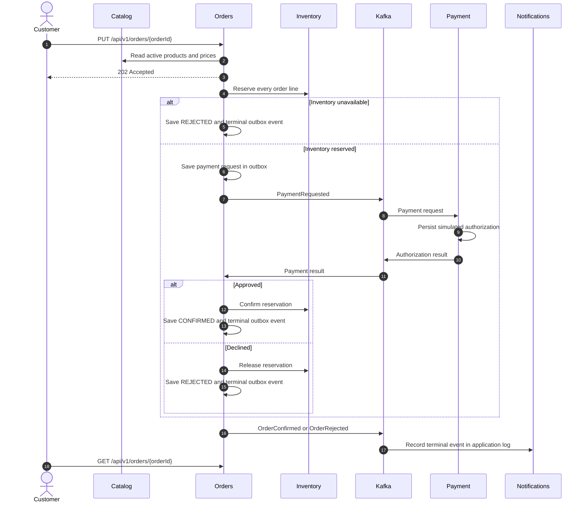

# Order flow

Orders snapshots catalog prices over HTTP. Inventory commands also use HTTP, while payment
authorization and terminal notifications use Kafka. Pending outbox records are retried after a
broker outage. The payment service stores one simulated authorization per order in its own database.

